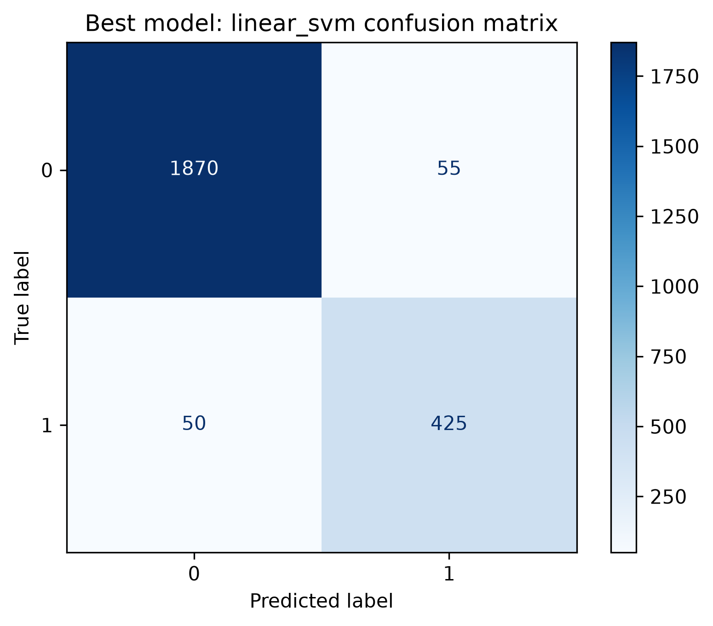

# IT-Type Job Classification

Classifies job postings as IT or non-IT using TF-IDF and sequence-based text models.

## Models

The notebook compares a Linear SVM, Random Forest, and Bi-LSTM using validation macro-F1. The **Linear SVM** performed best and achieved **95.6% test accuracy** (2,295 of 2,400 predictions correct).

## Usage

Open and run [`impl/IT_Type_Job_Classification.ipynb`](impl/IT_Type_Job_Classification.ipynb). The dataset is expected at `data/online-job-postings.csv`.

Generated plots and the selected model are saved under `result/`.

Dataset: [Armenian Online Job Postings](https://www.kaggle.com/datasets/udacity/armenian-online-job-postings)
